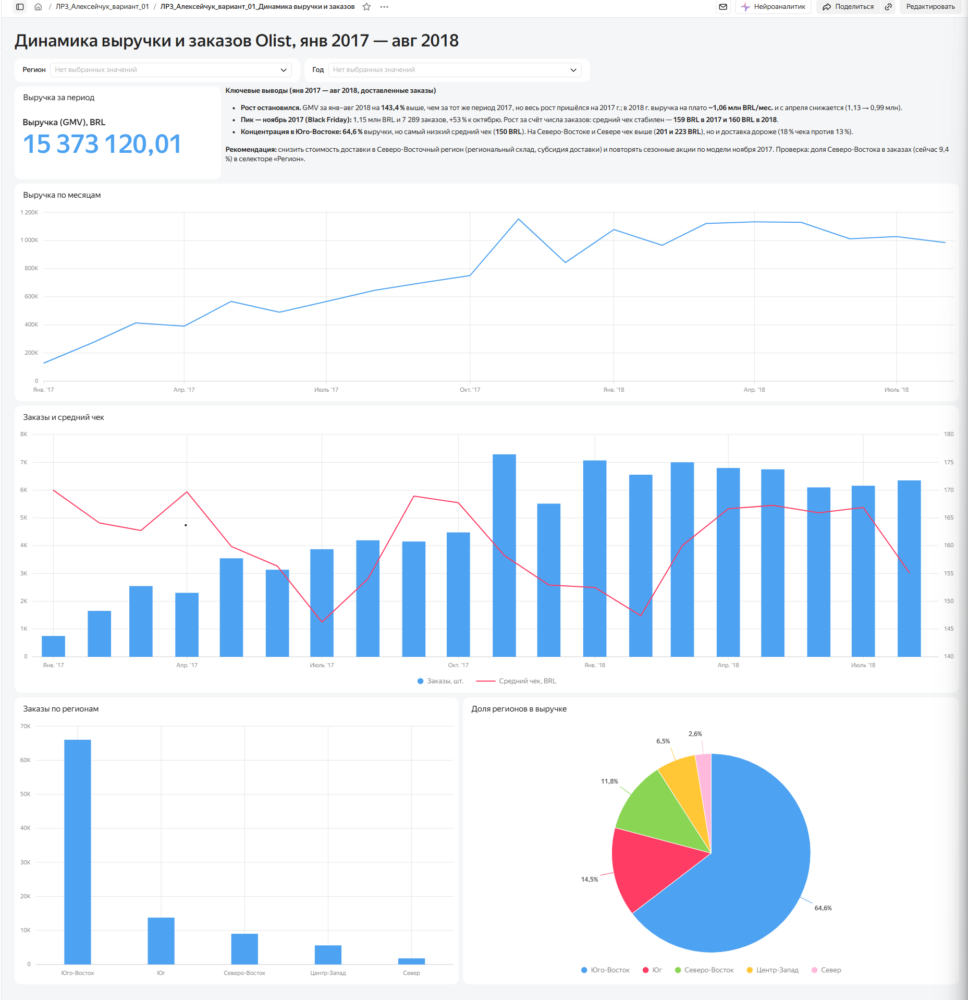

# ЛР-3. Аналитический дашборд для бизнес-кейса — вариант 1

**Студент:** Фамилия И.О. · **группа:** ББИ-00
**Бизнес-кейс:** Динамика выручки и заказов

## Цель работы
Как меняются выручка (GMV), число заказов и средний чек по месяцам и макрорегионам? Есть ли устойчивый рост?

## Исследуемые метрики
- **Средний чек** = `SUM([gmv]) / SUM([orders])`

## Архитектура решения
Kaggle (Olist, 9 CSV) → Python (`urllib`, `pandas`) → SQLite: RAW → STAGING → CORE → витрина `dm_v01_sales_monthly` → CSV → Yandex DataLens.

## Технологический стек
Python 3.13.18, pandas 3.0.5, SQLite 3.53.1, Google Colab / Jupyter, Yandex DataLens.

## Схема данных
Слои: `raw_*` (9 таблиц) → `stg_*` (типизация, очистка) → `core_order`, `core_item`, `dim_state` → `dm_v01_sales_monthly` (VIEW).
<!-- вставьте скриншот или ER-диаграмму: img/er.png -->

## SQL витрины
```sql
CREATE VIEW dm_v01_sales_monthly AS
SELECT purchase_month                        AS month,        -- 'YYYY-MM-01' → тип «Дата» в DataLens
       purchase_year                         AS year,
       region,                                                -- макрорегион (рус.)
       customer_state                        AS state,        -- код штата (ключ)
       state_name,                                            -- название штата для подписей
       COUNT(*)                              AS orders,       -- доставленных заказов
       ROUND(SUM(order_value), 2)            AS gmv,          -- выручка: товары + доставка, BRL
       ROUND(SUM(goods_value), 2)            AS goods_value,  -- в т. ч. стоимость товаров
       ROUND(SUM(freight_value), 2)          AS freight_value,-- в т. ч. доставка
       SUM(items_cnt)                        AS items,        -- позиций (товаров) в заказах
       COUNT(DISTINCT customer_unique_id)    AS customers,    -- уникальных клиентов в месяце и штате
       state_lat, state_lng                                   -- центр штата (для карты, по желанию)
FROM core_order
WHERE order_status = 'delivered'
  AND purchase_month BETWEEN '2017-01-01' AND '2018-08-01'   -- только полные месяцы
GROUP BY purchase_month, purchase_year, region, customer_state, state_name, state_lat, state_lng
```

## Контрольные значения
| Вопрос | Ответ |
|---|---|
| Месяц с максимальной выручкой (YYYY-MM-01) | 2017-11-01 |
| Рост GMV за янв–авг 2018 к янв–авг 2017, % | 143.4 |

## Дашборд DataLens
Ссылка: 

| № | Тип | Название |
|---|---|---|
| 1 | Индикатор | Выручка за период |
| 2 | Линейная диаграмма | Выручка по месяцам |
| 3 | Столбчатая диаграмма | Заказы по регионам |
| 4 | Круговая диаграмма | Доля регионов в выручке |
| 5 | Комбинированная диаграмма | Заказы и средний чек |



## Контроль достоверности
Витрина сверена со слоем CORE: 96 211 доставленных заказов и GMV 15 373 120,01 BRL за январь 2017 — август 2018
совпадают до копейки (ячейка 5.4). Витрина строится из `core_order` (1 строка = 1 заказ), поэтому размножения строк
позициями и платежами нет; средний чек считается в DataLens как `SUM([gmv]) / SUM([orders])`, а не как среднее от средних.

## Выводы и бизнес-рекомендации
Период: январь 2017 — август 2018 (полные месяцы), только доставленные заказы; GMV = товары + доставка, BRL.

1. **Рост есть, но он закончился в начале 2018 г.** GMV за январь–август 2018 г. выше, чем за тот же период 2017 г., на **143,4 %**
   (контрольный вопрос 2). Однако весь рост пришёлся на 2017 г. (с 0,13 до 0,84–1,15 млн BRL в месяц), а в 2018 г. выручка стоит
   на плато **0,97–1,13 млн BRL в месяц** (в среднем 1,06 млн) и с апреля медленно снижается: 1,13 → 0,99 млн BRL в августе.
2. **Пик — ноябрь 2017 г. (Black Friday):** 1,15 млн BRL и 7 289 заказов, на 53 % больше октября (0,75 млн BRL)
   (контрольный вопрос 1). Рост обеспечен числом заказов: средний чек почти не меняется — **159,4 BRL в 2017 г. и 160,1 BRL в 2018 г.**
3. **Выручка сконцентрирована в Юго-Восточном регионе:** **64,6 %** GMV и 68,6 % заказов, один штат Сан-Паулу — 37,4 % GMV.
   При этом средний чек там самый низкий (**150 BRL**), а в Северо-Восточном и Северном регионах он выше — **201 и 223 BRL**,
   но и доля доставки в чеке выше: 17,9 % и 18,5 % против 13,2 % в Юго-Восточном.

**Рекомендация.** Поскольку рост в базовом регионе остановился, а клиенты Северо-Восточного региона покупают на треть дороже,
но платят заметно больше за доставку, стоит снизить стоимость доставки туда (региональный склад или партнёрская
логистика, субсидирование доставки для заказов от N BRL) и повторять сезонные акции по модели ноября 2017 г.
*Ожидаемый эффект:* рост доли Северо-Восточного региона в заказах (сейчас 9,4 %) без снижения среднего чека.
*Как проверить:* на дашборде выбрать в селекторе `region` = «Северо-Восток» и сравнить помесячные заказы и долю доставки
(`freight_value / gmv`) до и после изменения.

**Ограничения данных:** 2016 г. и сентябрь–октябрь 2018 г. исключены как неполные; учтены только доставленные заказы (96 211);
поле `customers` — уникальные клиенты внутри месяца и штата, их сумма по месяцам больше числа уникальных клиентов за период;
данные Olist обезличены и охватывают одну площадку, поэтому выводы описывают её, а не весь рынок Бразилии.
